<!-- Animated contribution graph: real GitHub data, regenerated daily by GitHub Actions. -->

<h3><code>ayush@github ~ $ ./contributions.sh</code></h3>

 
 

<!-- Head-only ASCII portrait + GitHub stats card.
     Rebuild portrait locally:
     python scripts/prep_photo.py
     python scripts/make_ascii_svg.py -->

<h3><code>ayush@github ~ $ whoami</code></h3>

<table>
<tr>
<td valign="top"></td>
<td valign="top"></td>
</tr>
</table>

 
 

<h3><code>ayush@github ~ $ ./links.sh</code></h3>

<b>MCA Student · Aspiring DevOps Engineer</b>

 

